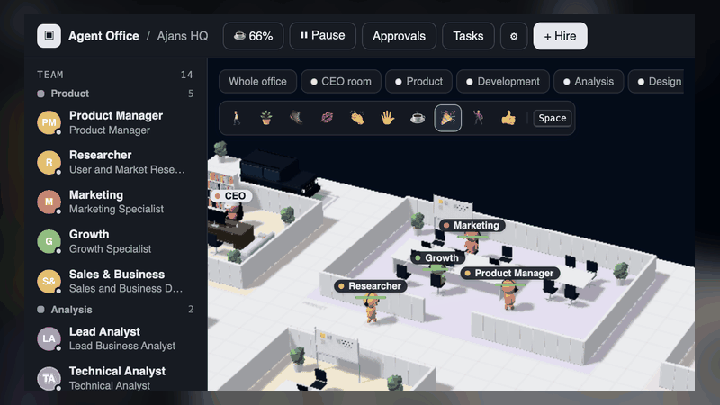
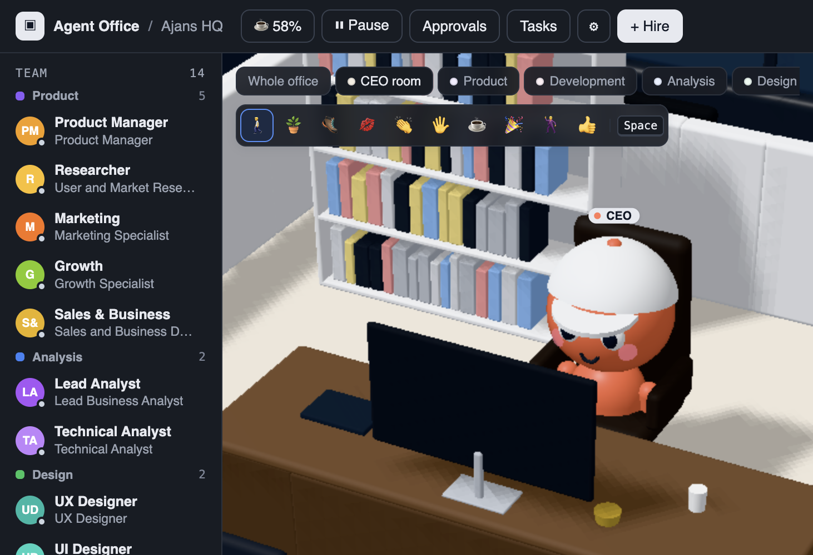
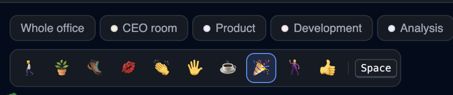

# Agent Office

<div align="center">
  <p><strong>A living HQ for your AI coding team.</strong></p>
  <p>Hire agents. Delegate work. Watch the whole team move from request to delivery—in a playful 3D office.</p>
  <p><a href="README.md"><strong>English</strong></a> · <a href="README.tr.md">Türkçe</a></p>
</div>

<p align="center">
  
</p>

Agent Office brings Claude Code, Codex CLI, Cursor CLI and other coding agents into one visible workflow—with delegation, live task activity, review tools, approvals and budget controls. The interface is available in English and Turkish (⚙️ Settings → Language; first run follows `LOCALE`/`LANG`).

| 🧠 **Delegate** | 👀 **See the work** | 🛡️ **Stay in control** |
|---|---|---|
| Agents hand tasks to teammates and send reports back automatically. | Follow the team in 3D; inspect live transcripts, files and changes. | Set budgets, request approvals and review Git worktrees before merge. |

## Quick start

```bash
npm install
npm start          # → http://localhost:4317
```

Requires Node.js 22+ and at least one supported agent CLI installed and authenticated.

Agent CLIs are found automatically (PATH, `~/.local/bin`, for Claude also the CLI bundled in the Claude desktop app). If one is not found, set its path with `CLAUDE_BIN` / `CODEX_BIN` / `CURSOR_BIN` / `OPENCODE_BIN`, or in ⚙️ Settings (one path field per CLI).

## Screenshots

<p align="center">
  
</p>
<p align="center"><em>Your own room at the heart of the office.</em></p>

<p align="center">
  
</p>
<p align="center"><em>Choose a playful action and trigger it with Space.</em></p>

## Features

- **Hiring** — an AI agent or a human worker. Each AI agent picks its CLI: Claude Code, Codex CLI or Cursor CLI (more via [providers](CONTRIBUTING.md)); Cursor agents cannot delegate (no per-run MCP). Role presets, model, permission mode, working directory, extra allowed tools and team.
- **Tasks** — click an agent and write the task. Each task runs as a separate CLI process (e.g. `claude -p --output-format stream-json`); the agent remembers its session (`--resume`).
- **Delegation** — every agent gets an MCP server named `office`: `list_team`, `delegate_task`, `task_status`, `request_approval`, `remember`, `recall`. When an agent delegates, the other walks over and an envelope flies; when the work finishes, the report returns to the delegator automatically as a new message.
- **Human workers** — agents can delegate to them too; you close the task with **Complete** and write the result (human-in-the-loop).
- **Live 3D office** — a working agent sits at their desk and types, showing the current tool in a speech bubble; idle ones go to the coffee corner, sofa, dining and game areas, or the sleep room.
- **Automatic office** — the layout is built from the headcount (tiers of 3 / 5 / 7 / 10 / 15 / 20): a closed meeting room from 5, dining and game areas from 7, a sleep room from 10. Every team of two or more gets its own walled room and a single shared table (a second table above 10 people); desks are assigned automatically. The room buttons above the stage, or the room name on the floor, move the camera to that room.
- **Company structure and sequential flow** — the first launch sets up 5 teams and 14 people (can be reinstalled from ⚙️ Settings; defined in `src/shared/company/`):
  **Product** (Product Manager; Researcher, Marketing, Growth, Sales & Business), **Analysis** (Baş Analist, Teknik Analist), **Design** (UX Tasarımcı, UI Tasarımcı), **Development** (Tech Lead, Frontend Developer, Backend Developer), **Test** (Test Lideri, Otomasyon Testçisi).
  As the CEO you give the work to the Product Manager. The PM runs discovery with the Product team if needed, writes the requirements, and hands the work to the Analysis → Design → Development → Test leads in order. Each lead splits the work within their team, does their own share, merges the parts and sends a single report to the PM (the server holds the report until the subtasks finish). If the tests fail, the work goes back to Development; at the end the PM gives you a delivery summary. All outputs live in the working directory under `docs/<request-code>/`: 0-kesif, 1-gereksinimler, 2-analiz, 3-tasarim, 4-gelistirme, 5-test-raporu, 6-lansman, durum.
- **PM chat** — the 💬 bubble at the bottom right opens a chat window with the Product Manager: you give work from there (Enter sends, Shift+Enter inserts a newline), and every PM reply, received report and task handed to the teams appears in order; replies that arrive while the window is closed are counted on the bubble.
- **CEO room** — you (the player) are the CEO: every office has your own room with a door, an executive desk, and a G-Class SUV in the parking spot right behind the back wall. You start the day at your seat; clicking your desk walks you there and sits you down. Agents do not enter your room in their free time.
- **CEO action modes** — select an action from the compact toolbar above the office and press `Space`: throw a plant, kick, blow a kiss, applaud, high-five, offer coffee, celebrate nearby agents with confetti, dance, or send a thumbs-up. Most actions need an employee nearby; plant throwing and confetti work from farther away. These are playful client-side effects and do not change tasks or agent data.
- **Light and dark theme** — ⚙️ Settings → *Theme*: follows the system by default, kept per browser. Motion is reduced when the system asks for it.
- **Team files** — ⚙️ Settings exports the team to a JSON file (role, prompt, CLI, model, permissions; no history, memory or folders) and imports one, added to the team or replacing it; *Delete the whole team* fires everyone. Imports warn about workers with full authority.
- **Teams** — the team list is grouped by team (same color as the room floor). Agents see teams in `list_team` and delegate to their own team first.
- **Live idle behavior** — whoever finishes work goes to the game area or the coffee corner, at lunchtime to the dining area; whoever stays idle for a long time sleeps in the sleep room 💤.
- **Status signs** — an agent who needs you carries an icon overhead and a ring on the floor until the cause is gone: approval pending, failed task or merge conflict, blocked with its reason, CLI limit, paused office, held report. They wait at their desk instead of strolling off; the same reason shows in the team list, and clicking either opens the right place. *Clear sign* on a task card drops a failure you will not retry.
- **Task board** — all tasks in Queued / Running / Done / Error columns. *Full screen* in the drawer's header gives any of its tabs the whole window; Esc goes back.
- **Flow and spend** — the drawer's *Flow* tab shows each request as a delegation tree (who handed what to whom, status, duration, cost) and the spend by team and by member.
- **Task transcript** — picking a step in *Flow* shows everything that task did, live: the whole log of the task (the newest 1000 entries, with a notice when it is longer), a filter by entry kind, and tool calls that expand to their full input.
- **Outputs** — the *Outputs* tab browses the shared working directory (newest files first, search, Markdown and tables rendered, *Full screen* for reading; Esc leaves it).
- **Recurring tasks** — in an agent's *Tasks* tab, *+ Schedule* gives it the same task every 15 min … every week (daily/weekly at a fixed time).
- **Git worktrees (optional)** — ⚙️ Settings → *Give each agent its own git worktree*: every agent works on its own `agent/<name>` branch under `.agent-worktrees/`, and after each finished task its changes are committed and merged into the main branch before the report goes up. On a conflict the branch is kept for you to merge. A working directory that is not a repository becomes one.
- **Review surface** — with worktrees on, picking a step in *Flow* shows what it changed (files with added/removed lines, and the patch; with worktrees off, the list of written files), and the task says what became of its work: *Merged*, *Awaiting approval*, *Rejected* or *Conflict*. A conflict is no clean success any more: the report says the work is not in, and *Have the agent resolve it* gives it back to the agent. ⚙️ Settings → *Ask for approval before merging* (off by default) holds each run's changes for your decision in the *Approvals* tab; until then its report waits and that agent starts nothing new, and rejecting drops the work from the branch.
- **Budget and limits** — ⚙️ Settings → *Budget and limits*: a daily budget, a daily budget per agent and a daily run-time limit in minutes that works for every CLI (when reached, new tasks wait in the queue until midnight or until you raise the cap; the top bar shows today's spend against the cap), a maximum number of agents running at once, and a time limit per task (default 60 min; a run over it is stopped and fails). 0 turns a limit off.
- **Honest cost accounting** — whatever a run reports counts, failed, cancelled and timed-out runs included, and running tasks count against the budget. Where nothing was reported (Codex and Cursor never do; a run cut off midway often cannot) the task shows *cost unknown* instead of $0.
- **Shared knowledge** — ⚙️ Settings → *Office notes* go into every agent's system prompt, on every CLI. Agents can also leave notes for each other with `remember` and search them with `recall`; the drawer's *Knowledge* tab lets you read, edit, delete and pin them. An agent's note stays unverified (`recall` labels it so, and it never enters a prompt) until you pin it; pinned notes enter every prompt up to a size budget, and the tab flags any that did not fit.
- **Human approval** — agents call the `request_approval` team tool before the steps listed in ⚙️ Settings → *Steps that need approval* (by default: push, deploy, deleting files, new dependencies, paid services, outgoing messages), then end their turn. The request appears in the drawer's *Approvals* tab (badge in the top bar, toast, desktop notification); your decision and note reach the agent as a new message, and its report to its boss waits until it has acted on the decision. Leave the list empty to turn this off.
- **CLI limits and logins** — a usage limit does not fail the task: it goes back in the queue, the report chain hears nothing, and that CLI waits until the reset time in the message (or a growing backoff) and then continues in the same session; after 5 tries it fails normally. A failed login pauses that CLI's queue with the reason until you log in and press *Resume now* in ⚙️ Settings, where each CLI also shows the result of a real `--version` health check.
- **Office controls** — *Pause* in the top bar holds the whole office (running tasks finish, nothing new starts, schedules wait and run once on resume; it survives a restart). A schedule whose last task is still queued, behind a CLI limit or a budget for example, gives no other until that one starts. ⚙️ Settings → *Budget and limits* caps each chain's turns (100) and cost ($20), reports included, so agents cannot pass work back and forth forever: at the limit the next step waits with the reason on its card until you raise the limit or cancel the chain. A failed task has *Retry*, which runs it again in the same place of the chain (`POST /api/tasks/:id/retry`; an unread failure report is withdrawn, one already read is corrected, and no second final report goes up), and a queued task's prompt can be edited.
- **Stuck chains** — a task card says why a report is waiting (*2 subtasks, 1 approval*); cancelling or firing releases it, *Cancel chain* stops a task and everything under it, and after a restart only chains active in the last 24 hours send their report by themselves (older ones wait for *Send report*, since reading a report is a paid run). So do chains a restart cut off, unless *Continue interrupted tasks* is on. A report always says how the agent's last turn under it went, and *Retry* or *Resolve* on that turn sends it again as a correction or follow-up. Cancelling a retry puts the failure back on hold, for *Send report*.
- **Clean shutdown and restarts** — on `Ctrl+C`, a closed terminal or `npm run bg:stop` the office stops its CLIs with everything they started (forced if they do not go) and saves. A run with no output for the *Silence limit* is stopped and fails. Interrupted tasks fail at the next start and their reports wait for *Send report*, so a restart starts no chain by itself. With *Continue interrupted tasks* on (off by default: it starts paid runs at boot) they continue in their session once instead, and the reports of those that still fail go out.
- **Notifications, backups, export** — optional desktop notifications while the tab is in the background; `data/state.json` is backed up hourly to `data/backups/` (the last 48 are kept, and a broken state file is restored from them); ⚙️ Settings → *Export* downloads everything as JSON.
- **Background / network** — `npm run bg` builds and runs the server in the background on `0.0.0.0` (reachable from your Wi-Fi; there is no login, so only on trusted networks); `npm run bg:stop`, `bg:status`, `bg:logs`. `HOST` picks the interface for `npm start`.

## Controls

| Key | Action |
|---|---|
| `W A S D` / arrows | Walk your character (relative to the camera) |
| `Shift` | Run |
| `E` | Talk to a nearby agent — opens their panel, ready to write a task |
| `F` | Toggle camera follow |
| `Space` | Perform the selected action mode |
| Click the floor | Your character walks there |
| `Esc` | Close the panel / task board |

The player's name and color change in ⚙️ Settings, which opens as a full page (Esc closes it). ⚙️ Settings → *General* has a Performance–Quality slider for the 3D office (resolution, shadows, ambient occlusion, frame cap); by default it steps down by itself if the frame rate stays low. Nothing is drawn while a full-screen page covers the office.

## Structure

| Path | Purpose |
|---|---|
| `src/server/` | Clean-architecture server on Hono: `domain/` (rules, ports), `application/` (use-case services), `infrastructure/` (JSON state, SSE, process runner, `providers/` — one adapter per agent CLI), `interface/` (HTTP routes + zod schemas), `main.ts` (composition root) |
| `src/mcp/office-mcp.ts` | MCP stdio server exposing the team tools to agents (official MCP SDK) |
| `src/shared/` | Pure modules shared by the server, browser and tests: `i18n/` (Turkish and English catalogs), `company/` (default company: teams, roles, prompts per language), `layout.ts` (office layout), `catalog.ts` (furniture/grid), `types.ts` (data model) |
| `src/client/` | React + Zustand UI built with Vite, layered: `domain/` (pure view logic), `application/` (store, use cases, ports), `infrastructure/` (HTTP/SSE gateway, three.js `world.ts`/`furniture.ts`), `presentation/` (React components), `main.tsx` (composition root) |
| `src/**/*.test.ts` | Tests (`npm test`): task lifecycle and delegation chains, provider parsers and error rules, process runner, worktrees against real git, schedules, HTTP routes, state backups, client view logic and store, office layout, company consistency |

Commands: `npm start` (builds the client + starts the server), `npm run dev` (Vite; `/api` is proxied to 4317, start the server separately with `npm run server`), `npm run typecheck`, `npm test`.

## GitHub Pages

`.github/workflows/deploy-pages.yml` builds and publishes the static client on pushes to `main` (or manually via **Actions → Deploy static client to GitHub Pages → Run workflow**). Set **Settings → Pages → Build and deployment → Source** to **GitHub Actions**. GitHub Pages hosts only the frontend files; live data and actions still require the Hono `/api` and SSE server, so the full app needs a separately hosted backend. For local use, run `npm start`.

Agent logs are written to `data/logs/<agent>.jsonl`. To try things without touching real data, use `AGENT_OFFICE_DATA=/other/dir PORT=4400 npm start`. The shared working directory defaults to `workspace/`.

## About permissions

The default permission mode is `acceptEdits`: an agent can read and edit files but cannot run shell commands. If commands are needed, add e.g. `Bash(npm test:*)` to the agent's **extra allowed tools** field, or choose **Full authority** (`bypassPermissions`); that means the agent runs every command without asking.
