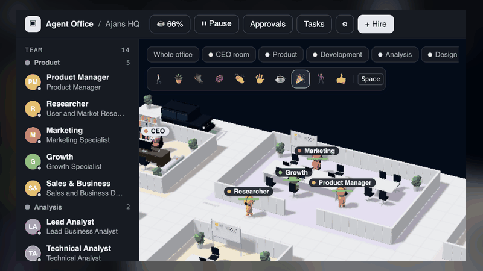
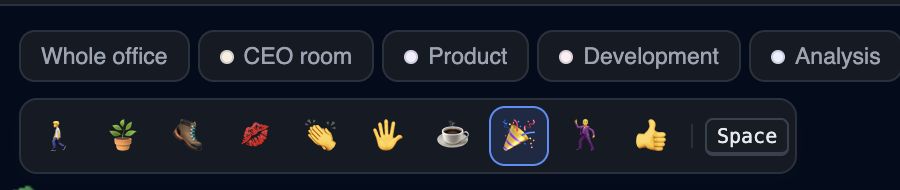

# Agent Office

<div align="center">
  <p><strong>Yapay zekâ kodlama ekibin için yaşayan bir ofis.</strong></p>
  <p>Ajanları işe al. İşleri devret. Ekip isteğin başlangıcından teslimata kadar birlikte çalışırken izle.</p>
  <p><a href="README.tr.md"><strong>Türkçe</strong></a> · <a href="README.md">English</a></p>
</div>

<p align="center">
  
</p>

Agent Office; Claude Code, Codex CLI, Cursor CLI ve diğer kodlama ajanlarını görünür bir iş akışında buluşturur. Görev devri, canlı etkinlik, inceleme araçları, onaylar ve bütçe kontrolleri tek yerde. Arayüz Türkçe ve İngilizce kullanılabilir (⚙️ Ayarlar → Dil; ilk açılışta `LOCALE`/`LANG` kullanılır).

| 🧠 **İşi devret** | 👀 **Çalışmayı izle** | 🛡️ **Kontrol sende** |
|---|---|---|
| Ajanlar işleri takım arkadaşlarına devreder, raporları otomatik geri gönderir. | Ekibi 3B ofiste takip et; günlükleri, dosyaları ve değişiklikleri incele. | Bütçe belirle, onay iste ve Git worktree'lerini birleştirmeden önce gözden geçir. |

## Hızlı başlangıç

```bash
npm install
npm start          # → http://localhost:4317
```

Node.js 22+ ve kurulu, oturumu açılmış en az bir ajan CLI'ı gerekir.

Ajan CLI'ları otomatik bulunur (`PATH`, `~/.local/bin`; Claude için Claude masaüstü uygulamasıyla gelen CLI da aranır). Bulunamazsa `CLAUDE_BIN` / `CODEX_BIN` / `CURSOR_BIN` / `OPENCODE_BIN` ortam değişkenleriyle veya ⚙️ Ayarlar'daki CLI alanlarından yolunu belirleyebilirsin.

## Ekran görüntüleri

<p align="center">
  
</p>
<p align="center"><em>Ofisin merkezindeki sana özel oda.</em></p>

<p align="center">
  
</p>
<p align="center"><em>Eğlenceli bir eylem seç ve Space ile uygula.</em></p>

## Özellikler

- **İşe alım** — yapay zekâ ajanı veya insan çalışan işe al. Ajanlar Claude Code, Codex CLI ya da Cursor CLI kullanabilir; diğer sağlayıcılar için [CONTRIBUTING.md](CONTRIBUTING.md) dosyasına bak. Rol, model, izin modu, çalışma klasörü, ek araç izinleri ve takım atanabilir.
- **Görevler ve devir** — bir ajana tıklayıp görev ver. Her görev ayrı bir CLI sürecinde çalışır ve ajan oturumunu devam ettirir. Ajanlar `office` MCP sunucusundaki `list_team`, `delegate_task`, `task_status`, `request_approval`, `remember` ve `recall` araçlarıyla birbirlerine iş devredebilir. Devir sırasında ajanlar birbirine yürür; tamamlanan işin raporu otomatik olarak devredene döner.
- **İnsan çalışanlar** — ajanlar insanlara da görev verebilir. İnsan çalışan görevi **Tamamla** düğmesiyle bitirip sonucunu yazar.
- **Canlı 3B ofis** — çalışan ajan masasında çalışır ve kullandığı araç konuşma balonunda görünür. Boştaki ajanlar kahve köşesi, kanepe, yemek ve oyun alanları arasında dolaşır; uzun süre boşta kalanlar uyku odasına gider.
- **Otomatik ofis ve takımlar** — ofis yerleşimi çalışan sayısına göre oluşur; takımların kendi odaları ve ortak masaları bulunur. Oda düğmeleriyle kamerayı ilgili alana taşıyabilirsin. İlk açılışta 5 takım ve 14 çalışan kurulur; şirket tanımları `src/shared/company/` altındadır. Ürün Yöneticisi işi keşif, analiz, tasarım, geliştirme ve test adımlarından sırasıyla geçirip sonunda teslimat özeti verir.
- **Ürün Yöneticisi sohbeti** — sağ alttaki 💬 balonundan Ürün Yöneticisi'ne iş verebilir ve yanıtları takip edebilirsin. Enter gönderir, Shift+Enter yeni satır ekler; sohbet kapalıyken gelen yanıtlar okunmamış sayacına eklenir.
- **CEO odası** — oyuncu CEO'dur. Her ofiste kapılı özel oda, yönetici masası ve arka duvarın dışında park etmiş bir G-Serisi SUV bulunur. Masaya tıklayınca CEO oraya yürüyüp oturur.
- **CEO eylem modları** — ofisin üstündeki kompakt araç çubuğundan mod seçip `Space` tuşuna bas: **saksı at**, **tekme**, **öpücük**, **alkış**, **çak bir beşlik**, **kahve ısmarla**, **konfeti**, **dans** veya **başparmak**. Yakın etkileşimler için çalışana yaklaş; saksı ve konfeti daha uzaktan kullanılabilir. Bunlar görevleri veya ajan verilerini değiştirmeyen eğlenceli görsel efektlerdir.
- **Tema ve takım dosyaları** — açık/koyu tema sistem ayarını izleyebilir. ⚙️ Ayarlar'dan takımı JSON olarak dışa aktarabilir veya içe aktarabilirsin; içe aktarma takıma ekler ya da mevcut takımın yerine geçer.
- **Görev panosu ve akış** — görev panosu işleri kuyruk, sürüyor, bitti ve hata sütunlarında gösterir. *Akış* sekmesi görev devir ağacını, durumları, süreleri ve maliyetleri gösterir; tamamlanan akışlar tek tek gizlenebilir ve geçmişten geri getirilebilir. Bir görev adımını seçerek canlı günlüğünü ve araç çağrılarının girdilerini inceleyebilirsin.
- **Çıktılar ve zamanlamalar** — *Çıktılar* sekmesi ortak çalışma klasöründeki dosyaları arayıp önizlemeyi sağlar. Ajanın *Görevler* sekmesinden aynı görevi düzenli aralıklarla veya günlük/haftalık sabit saatte çalışacak şekilde zamanlayabilirsin.
- **Git worktree'leri (isteğe bağlı)** — ⚙️ Ayarlar'da her ajana ayrı worktree açıldığında ajanlar kendi dallarında çalışır; tamamlanan değişiklikler commit edilip ana dala birleştirilir. Çakışmada dal korunur. İstersen birleştirme öncesi onay isteyebilir ve *Onaylar* sekmesinden karar verebilirsin.
- **Bütçe ve güvenlik** — günlük bütçe, ajan başına bütçe, çalışma süresi, eşzamanlı ajan ve görev süresi sınırları tanımlanabilir. Maliyeti bildirilmemiş işler `$0` yerine *maliyet bilinmiyor* olarak görünür. Ajanlar belirli işlemler için `request_approval` ile insan onayı isteyebilir.
- **Bilgi ve durum işaretleri** — ofis notları her ajanın istemine eklenebilir; ajanlar `remember` ve `recall` ile not paylaşabilir. Onay bekleyen, başarısız veya engellenmiş işler ajanın üzerinde durum işareti gösterir ve ilgili ekrana bağlantı verir.
- **Kontroller ve bildirimler** — ofisi duraklatabilir, CLI limitlerini yönetebilir, arka plan bildirimlerini açabilir ve tüm durumu JSON olarak dışa aktarabilirsin. Durum dosyası saatlik yedeklenir. `npm run bg` sunucuyu yerel ağda arka planda çalıştırır; kimlik doğrulama olmadığı için yalnızca güvendiğin ağlarda kullan.

## Kontroller

| Tuş | Eylem |
|---|---|
| `W A S D` / ok tuşları | Karakteri kameraya göre hareket ettir |
| `Shift` | Koş |
| `E` | Yakındaki ajanla konuş ve görev panelini aç |
| `F` | Kamera takibini aç/kapat |
| `Space` | Seçili eylem modunu uygula |
| Zemine tıkla | Karakteri tıklanan konuma yürüt |
| `Esc` | Paneli veya görev panosunu kapat |

Oyuncunun adı ve rengi ⚙️ Ayarlar'dan değiştirilebilir. *Genel* bölümünde 3B ofisin performans/kalite ayarı bulunur. Tam ekran sayfa ofisin üzerini kapladığında sahne çizilmez.

## Proje yapısı

| Yol | Amaç |
|---|---|
| `src/server/` | Hono tabanlı sunucu: domain kuralları, uygulama servisleri, altyapı ve HTTP arayüzü |
| `src/mcp/office-mcp.ts` | Ajanlara takım araçlarını sunan MCP stdio sunucusu |
| `src/shared/` | Sunucu, tarayıcı ve testlerin paylaştığı i18n, şirket, yerleşim, mobilya ve veri modeli modülleri |
| `src/client/` | React + Zustand arayüzü; `domain/`, `application/`, `infrastructure/` ve `presentation/` katmanları |
| `src/**/*.test.ts` | `npm test` ile çalışan sunucu, istemci, iş akışı, yerleşim ve şirket testleri |

Komutlar: `npm start` istemciyi derleyip sunucuyu başlatır; `npm run dev` Vite'ı çalıştırır (API için sunucuyu ayrıca `npm run server` ile başlat); `npm run typecheck` ve `npm test` doğrulama komutlarıdır.

## GitHub Pages

`.github/workflows/deploy-pages.yml`, `main` dalına gönderimlerde veya **Actions → Deploy static client to GitHub Pages → Run workflow** ile elle statik istemciyi derleyip yayınlar. Bir kez **Settings → Pages → Build and deployment → Source** ayarını **GitHub Actions** yap. GitHub Pages yalnızca frontend dosyalarını sunar; canlı veri ve eylemler için Hono `/api` ve SSE sunucusu gerekir. Tam uygulama için bu backend'i ayrıca barındırmalısın; yerelde `npm start` kullanabilirsin.

Ajan günlükleri `data/logs/<agent>.jsonl` altında tutulur. Gerçek verilere dokunmadan denemek için `AGENT_OFFICE_DATA=/other/dir PORT=4400 npm start` kullanabilirsin. Paylaşılan çalışma klasörünün varsayılanı `workspace/` dizinidir.

## İzinler hakkında

Varsayılan izin modu `acceptEdits`'tir: ajan dosyaları okuyup düzenleyebilir ancak kabuk komutlarını çalıştıramaz. Komut çalıştırması gerekiyorsa ajanın **Ek izinli araçlar** alanına örneğin `Bash(npm test:*)` ekle veya **Tam yetki** (`bypassPermissions`) seç. Tam yetki, ajanın her komutu onay istemeden çalıştırması anlamına gelir.
